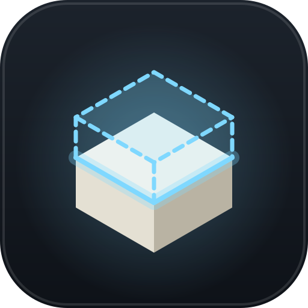

  

<h1 align="center">Heavymatica</h1>

  Schematics for Minecraft with a simple placement UI and a cloud library that follows you to every world and server.

  
  
  
  
  
  

---

Heavymatica shows a building plan as a ghost in your world and helps you build it, block by block. It does what
Litematica does for most players, with far fewer menus: pick a schematic, put it where you want it, lock it, and build.

Your schematics live in **Heavymatica Cloud**, so the library you open on one server is the same one you find in
single player, on another server or on another computer.

> Heavymatica is in **alpha**. Things change between versions, and some Litematica features are still missing.

## What it does

- **One library everywhere.** Open it with `H`, drop in `.litematic`, `.schem` or `.nbt` files and they are uploaded
  to your account. You can also manage them on the website.
- **Simple placement.** Hold the remote, move, rotate and mirror the ghost, then lock it in place. Everything else is
  on one wheel (`V`).
- **See what is wrong.** A locked placement compares itself with the world: wrong blocks and missing blocks are
  marked, and a pointer leads you to the nearest mistake.
- **Build in layers.** Show one layer, a range of layers, or the layer at your feet, and optionally only the blocks
  you hold in your hand.
- **Materials.** See what the build still needs, what you carry and what you are short of. Swap block types (oak for
  spruce, for example) per placement without editing the schematic.
- **Easy Place and placement restriction.** Right-click a ghost to place the planned block there, or let the mod stop
  you from placing a block that does not match the plan.
- **Capture your own builds.** Mark two corners and save the area as a schematic, ready to upload. Export any entry to
  `.minecraft/schematics/` for other tools.
- **Creative paste.** In creative single player, paste a placement into the world at once and undo it again.
- **Works on any server.** Heavymatica runs on the client alone, vanilla servers included.
- **Plays well with others.** Ghosts stay visible with Iris shader packs, and Jade shows the ghost under your
  crosshair.

## Installing

1. Install [NeoForge](https://neoforged.net/) for Minecraft 26.1.2.
2. Download the latest jar from the [releases](https://github.com/Dirnei/heavymatica/releases) and put it into your
   `mods` folder.
3. Start the game, join a world and press `H` to open the library and sign in.

Keys can be changed in Options → Controls, settings in the library (gear icon) or in Mods → Heavymatica → Config.

## Feedback

Found a bug or missing something? [Open an issue](https://github.com/Dirnei/heavymatica/issues).
Want to build it yourself or help out? See [CONTRIBUTING.md](CONTRIBUTING.md).

## License

The mod is licensed under the [GNU LGPL v3.0](LICENSE), which builds on the [GNU GPL v3.0](COPYING). The cloud and
the websites are licensed under the [GNU AGPL v3.0](src/cloud/LICENSE).
