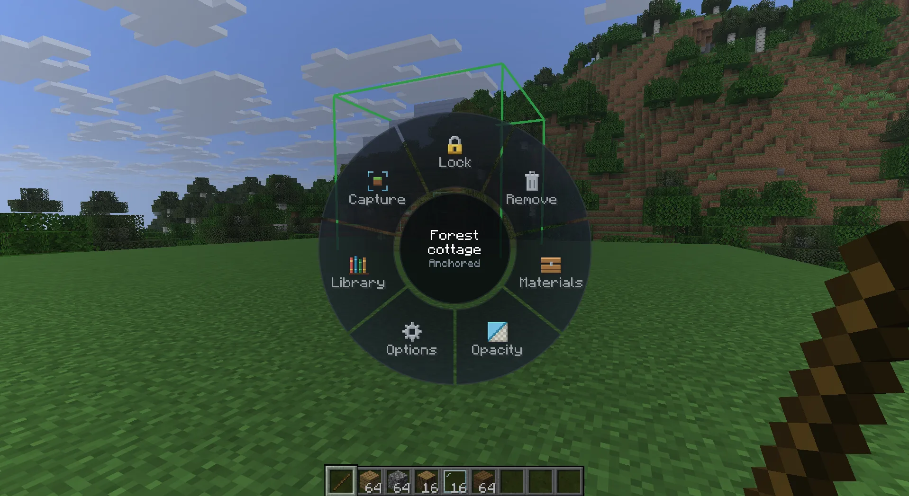

Every screenshot in the player guide is taken by a script, from a fresh world and a fresh local cloud. Run it after
UI changes or a Minecraft update, and commit the images it writes:

```
cd docs
npm ci
npx playwright install chromium   # once
npm run screenshots
```

It needs Docker, the .NET SDK, JDK 25 and Node, and takes about five minutes. Your own local cloud and dev runs may keep
running: the script uses its own ports (5190 for the cloud, 27190 and 9190 for its containers), its own containers
(`heavymatica-docs-mongo`, `heavymatica-docs-minio`) and its own game folder (`src/mod/heavymatica/fabric/runs/docs`).

## What it does

1. Builds the player website and the cloud into `docs/screenshots/.work` and starts the cloud in Development with
   throwaway MongoDB and MinIO containers. The cloud serves the built website itself.
2. Resets the game folder with fixed view settings (`options.txt`) and runs the Fabric client
   (`./gradlew :heavymatica:fabric:runDocs`, a 1600×900 window) as the player `HeavyDocs` with the steps in
   `docs/screenshots/client.steps`.
3. Signs a browser in as the same player through the cloud's development sign-in and runs
   `docs/screenshots/website.steps.mjs`.
4. Converts every screenshot to WebP in `docs/src/assets/screenshots/`, then stops the cloud and removes its containers.

`npm run screenshots -- --client-only` takes only the game's screenshots, and a path argument runs another steps
file, which helps while working on a scene.

## The scene

Nothing of the world is committed. `client.steps` creates a world from a seed, stops time, weather and mobs, clears a
meadow and builds the cottage with `fill` and `setblock` commands. The cottage is then captured, uploaded, removed and
placed again as a ghost, and partly rebuilt with a few deliberate mistakes for the comparison screenshots. The steps
are the [development aids](/develop/dev-aids/) the dev client already understands; each line is one step, and `#` starts
a comment.

The same seed gives the same terrain on the same Minecraft version. After a Minecraft update the terrain can change;
check the coordinates in `client.steps` when the pictures look wrong.

## Using the images

Pages reference images relative to themselves:

```md

```

A new screenshot is a new `screenshot=<name>` step in `client.steps`, or a new entry in `website.steps.mjs`, followed by
a run of the script.
