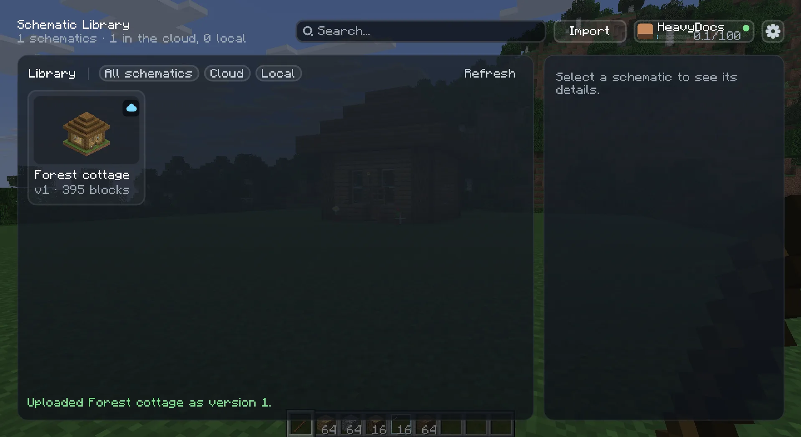
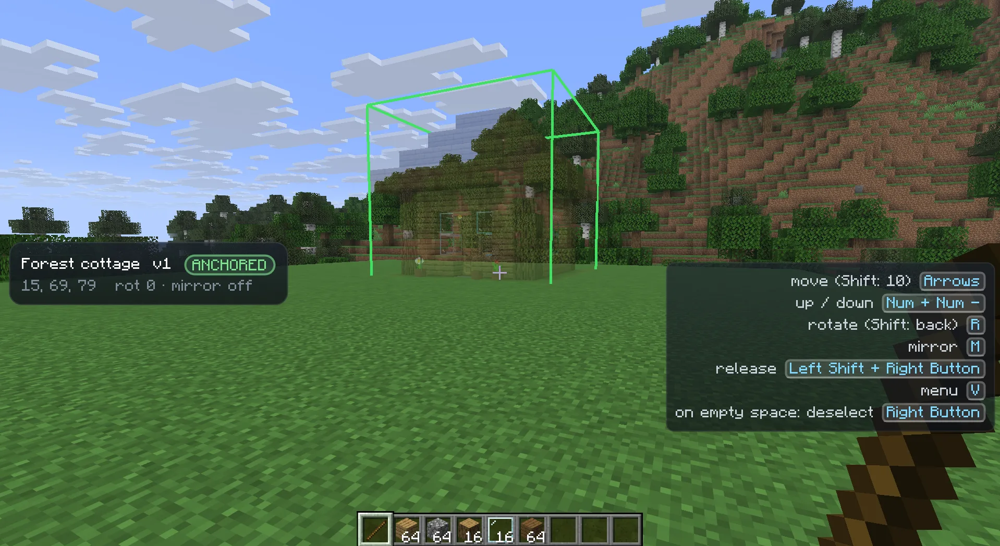
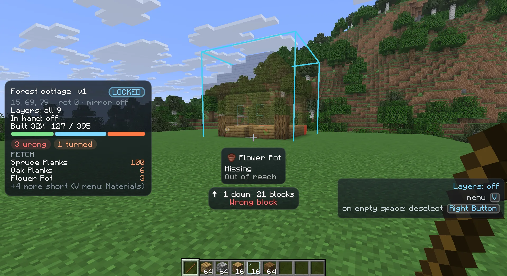

import { Steps } from '@astrojs/starlight/components';

This page takes you through one whole build, start to finish. Every step links to a page with the details.

You need Heavymatica [installed](/play/install/) and at least one schematic in your library. If the library is
empty, it opens on the import screen, which lists the files in your `schematics` folder. See
[Import and export](/play/import-export/) or [Capture](/play/capture/).

## 1. Pick a schematic

<Steps>
1. Join a world and press <kbd>H</kbd> to open the library.
2. Click a schematic card. Its details show on the side.
3. If it is a cloud schematic with several versions, pick the version you want.
4. Click **Place**.
</Steps>

The library closes. More about the library on [Library](/play/library/).

## 2. Hold the remote

Placements are controlled with the **remote**. By default that is a plain **stick** in your main hand. No special item
is needed, so it works on any server.

If you clicked **Place** without the remote in your hand, a message says `Hold a Stick to place`. Take a stick into your
main hand and the ghost appears.

While you hold the remote, a panel on the left shows the selected placement, and the bottom-right corner lists the keys
you can use right now. See [The remote](/play/remote/).

## 3. Put it down

The new placement is **following**: its ghost sits on whatever block you look at, up to 64 blocks away.

<Steps>
1. Look at the spot where the build should stand.
2. Press <kbd>R</kbd> to rotate it 90° (<kbd>Shift</kbd> + <kbd>R</kbd> turns the other way) and <kbd>M</kbd> to
   mirror it.
3. Press <kbd>Numpad +</kbd> or <kbd>Numpad -</kbd> to raise or lower it against the block you look at.
4. Right-click to **anchor** it. It stays there and stops following your crosshair.
</Steps>

## 4. Fine-tune the position

With the placement anchored, nudge it into place:

- The arrow keys move it one block, relative to where you look: <kbd>↑</kbd> away from you, <kbd>↓</kbd> towards you,
  <kbd>←</kbd> and <kbd>→</kbd> sideways. Hold <kbd>Shift</kbd> to move 10 blocks.
- <kbd>Numpad +</kbd> and <kbd>Numpad -</kbd> move it up and down.
- <kbd>R</kbd> and <kbd>M</kbd> still rotate and mirror it.
- Sneak and right-click to pick it up again. It follows your crosshair until you right-click once more.

See [Placing and moving](/play/placement/) for everything about moving, selecting and removing placements.

## 5. Lock it

When the position is right, lock the placement so it can't move by accident:

<Steps>
1. Hold <kbd>V</kbd> to open the placement wheel.
2. Point the mouse at **Lock** and let go of <kbd>V</kbd>.
</Steps>

A locked placement starts comparing itself with the world. Blocks you have already built disappear from the ghost,
and mistakes get coloured boxes. The panel shows your progress in percent.

## 6. Pick layers

A big ghost is hard to build in. Show only part of it:

<Steps>
1. Open the wheel with <kbd>V</kbd> and pick **Layers**.
2. Pick **From-to** to show a fixed range of layers, or **Follow feet** to show the layers up to just above your feet.
3. In From-to, <kbd>↑</kbd> and <kbd>↓</kbd> move the range and <kbd>Numpad +</kbd> / <kbd>Numpad -</kbd> make it taller
   or shorter.
</Steps>

On a locked placement these layer keys also work while you hold blocks instead of the remote. See
[Layers](/play/layers/), including the in-hand filter that shows only the blocks you are holding.

## 7. Build

Now build in survival or creative as you normally would. Fetch the blocks you need: the wheel's **Materials** opens a
list of what is still short. See [Materials](/play/materials/).

Some helpers, all optional:

- Middle-click a ghost within reach to put its block into your hand.
- [Easy Place](/play/easy-place/): right-click a ghost with its item and the block lands exactly as planned.
- [Creative paste](/play/creative-paste/): in your own creative world, paste the whole build at once.

## 8. Follow your mistakes

The locked placement marks every position that doesn't match the plan:

| Box colour | Meaning |
| --- | --- |
| Red | Wrong block |
| Orange | Wrong orientation, too many, or not enough yet |
| Cyan | Wrong waterlogging |
| Yellow | Needs finishing, for example with a shovel or an axe |
| Magenta | Extra block where the plan has air |

Look at a ghost or a boxed block and a small HUD under the crosshair says what belongs there and what is wrong. To find
the next mistake on a large build, turn on the mistake pointer: open the wheel, pick **Options**, then **Mistakes**.
See [World comparison](/play/comparison/).

## 9. Finish

When every block matches, the placement finishes on its own: a sound plays, a toast names it, and the placement is
removed. Changed your mind? Open the wheel within 10 seconds and pick **Bring back** to get it back, still locked.
