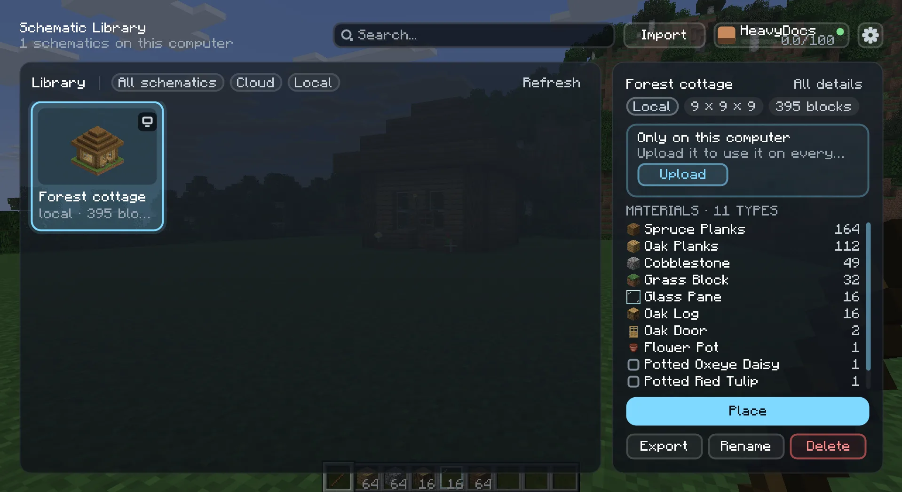
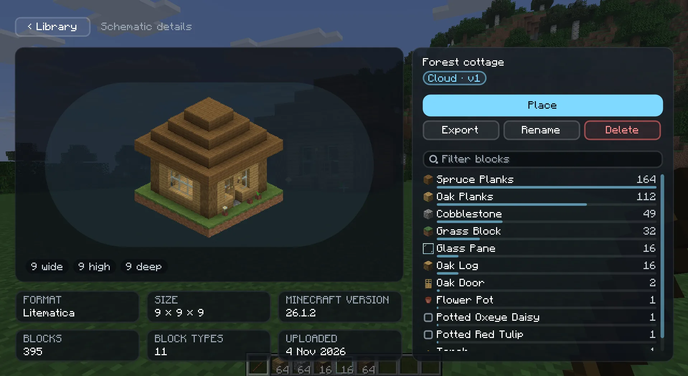
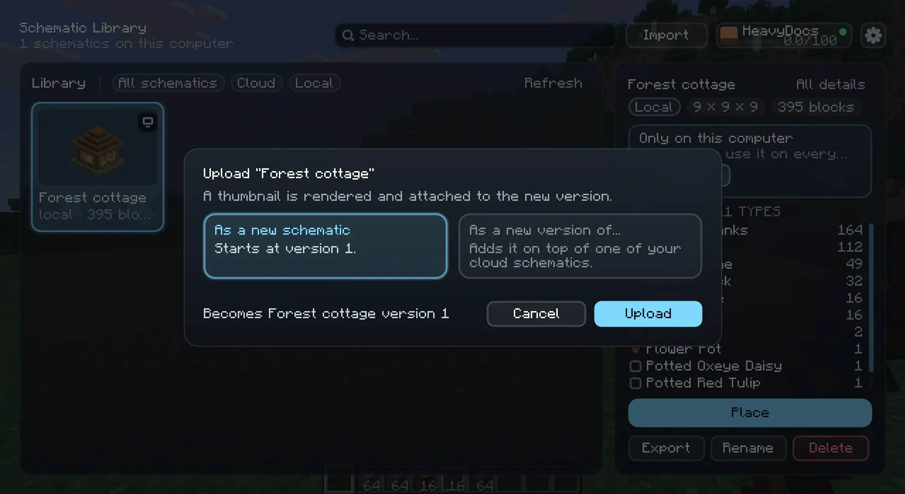
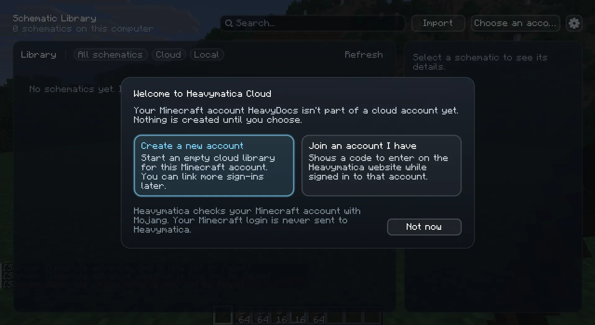

import { Aside, Steps, Badge } from '@astrojs/starlight/components';

The library is where all your schematics live: the ones on this computer and the ones in your Heavymatica Cloud
account, side by side. Press <kbd>H</kbd> in a world to open it. You can change the key in
[Options → Controls](/play/keys/).

<Aside type="caution" title="The cloud is in alpha">
  The Heavymatica Cloud is not open to everyone yet. Until it is, the library works with the schematics on your own
  computer only, and you won't see a **Sign in** button. Everything else on this page that isn't about the cloud works
  already. The last part of this page explains what you see until the cloud opens.
</Aside>

## Local and cloud schematics

Every schematic in the library is either **local** or **cloud**:

- **Local** schematics are stored on this computer only. You get them by importing files or by capturing a build. The
  details panel says "Local only: not uploaded to the cloud".
- **Cloud** schematics are stored in your Heavymatica Cloud account. They keep every version you upload, and you can use
  them on any computer and on the [website](/play/website/).

The title of the library tells you how many you have, for example "12 schematics · 9 in the cloud, 3 local". While
the cloud is shown, the **Cloud** and **Local** filters show only one kind.

When your library is empty, it opens the import screen for you, so you can bring in your first schematic. See
[Import and export](/play/import-export/) and [Capture](/play/capture/).

## Browsing

The library works like a file explorer:

- The top level shows your folders as folder cards, then the schematics that are in no folder. Local schematics are
  always on the top level.
- Click a folder card to open it. You see an **Up** card, the subfolders, and then the schematics directly in that
  folder. Each folder card shows how many schematics are in it, subfolders included.
- **All schematics** shows every schematic at once, whatever its folder, without folder cards.

Each card shows the schematic's thumbnail (or a placeholder when it has none), its name, its size and its block count.

## Searching and tags

Type in the search box to find schematics by name. Upper and lower case don't matter. Click a tag to show only
schematics with that tag. Search and tag work together: with the folder `houses` open, the tag `spruce` chosen and
`tow` typed, you see the schematics in `houses` or below it, tagged `spruce`, whose name contains `tow`.

Search and tags look in the open folder and every folder below it. On the top level they look everywhere.

## Details

Click a card to select it. Its details show in the panel beside the cards, and the cards stay where they are:

- every version, with its number and upload time, so you can pick an older one
- every block type of the chosen version with its count, most common first

Click **All details**, or double-click the card, to open the details page. It shows a large preview, the width, height
and depth, the file format, the Minecraft version when the file records one, the block count, the number of block types
and when it was added or uploaded. The block list there has a bar for each block's share and a filter box: type `oak`
to see only blocks whose name or ID contains `oak`. **‹ Library** takes you back with the same schematic selected.

Blocks the game doesn't know, for example from a mod you don't have installed, are marked as unknown. The details page
says how many block types are unknown.

## Using a schematic

The details panel offers these actions:

| Action | What it does | Local | Cloud |
| --- | --- | --- | --- |
| **Place** | Closes the library and starts a placement of the chosen version. See [Placement](/play/placement/). | yes | yes |
| **Export** | Writes the file to your `schematics` folder. See [Import and export](/play/import-export/). | yes | yes |
| **Rename** | Gives the schematic a new name. | yes | signed in |
| **Move** | Puts the schematic into a folder. | no | signed in |
| **Tags** | Sets the schematic's tags. | no | signed in |
| **Del. version** | Deletes the chosen version. A schematic keeps at least one version. | no | signed in |
| **Delete** | Deletes the schematic and all its versions. | yes | signed in |
| **Upload** | Uploads a local schematic to the cloud. | signed in | no |

An action you can't use right now is greyed out. Point at it to see why, for example "Sign in to the Heavymatica Cloud
to change cloud schematics."

### Folders and tags

- **Move** asks for a folder path, for example `houses/medieval`. A folder that doesn't exist yet is created. Leave the
  field empty to take the schematic out of every folder.
- **Tags** asks for tags separated by commas, for example `spruce, wip`.

Folders and tags are part of your cloud account, so they only exist for cloud schematics.

### Renaming and deleting

Delete always asks first and names the schematic or the version. Nothing is deleted until you confirm.

Deleting a local schematic removes it and the library's copy of the file from this computer. The file you imported it
from, for example in `schematics/`, stays where it is.

## Uploading to the cloud

Drop schematic files from your file manager anywhere onto the library. Heavymatica reads Litematica (`.litematic`),
WorldEdit (`.schem`, `.schematic`) and vanilla structure (`.nbt`) files. Each file becomes a local schematic first. If
a file is already in your library, Heavymatica asks whether to import it anyway or skip it.

To put a local schematic into the cloud:

<Steps>
1. Select the local schematic.
2. Click **Upload**.
3. Choose **As a new schematic** (it starts at version 1) or **As a new version of...** and pick one of your cloud
   schematics to add it to.
</Steps>

Heavymatica renders a thumbnail and attaches it to the new version. If the upload fails, or the file doesn't fit into
your storage, the schematic stays in your library as a local schematic.

Files are rejected when they are larger than 16 MiB, wider than 1024 blocks in any direction, hold more than 16,777,216
blocks, or are damaged.

## Signing in

You sign in with the Minecraft account you are playing with. There is no name, email or password to enter.

<Steps>
1. Open the library and click **Sign in** at the top.
2. The first time, the library asks whether to **Create a new account** or **Join an account I have**. Nothing is
   created until you choose. **Not now** leaves you signed out.
3. After that, you are signed in. The top of the library shows your Minecraft name and how much of your storage you use.
</Steps>

Heavymatica checks your Minecraft account with Mojang. Your Minecraft login is never sent to Heavymatica.

You stay signed in after a restart. If you start the game with a different Minecraft account, you are signed out until
you sign in with that one. When your session ends, for example after a long time away, the library says
"Signed out, sign in again". Your game is never interrupted by it.

Cloud sign-in needs a Microsoft-authenticated Minecraft account. It doesn't work in an offline-mode game.

## Your account

When you are signed in, click your name at the top of the library to open your account:

- **Storage** shows how much space you use out of your quota, in MiB. The same bar is under your name in the library.
- **Sign-ins on this account** lists every Minecraft account and website sign-in that opens this library, with the one
  you use marked **In use**. **Unlink** removes one after you confirm. The last sign-in can't be unlinked, and
  unlinking the one in use signs you out here.
- **Link another sign-in** shows a link code (see below).
- **Sign out** removes the saved session and the list of your cloud schematics from this computer. Your local
  schematics stay.

## Link codes

A link code connects another sign-in to your account, so that one library opens from all of them: in the game, on the
[website](/play/website/), and from your other Minecraft accounts. Codes are always shown in the game and entered on
the website. You never type a code into the game.

To add your GitHub sign-in from the website:

<Steps>
1. In the library, click your name, then **Link another sign-in**. The game shows a code such as `K7QM-3XRP`, a QR
   code and how long the code is valid. A code lasts 5 minutes.
2. On the website, sign in with GitHub and enter the code. Or scan the QR code with your phone: it opens the website
   with the code filled in.
3. Back in the game, the screen says who wants to link, for example "the GitHub sign-in steve-builds". Click
   **Confirm** if it is yours, or **Decline** if it isn't.
</Steps>

Nothing is linked until you confirm in the game. When the time runs out, the screen offers a **New code**.

To use the same library from a second Minecraft account, start the game with that account, sign in and choose **Join
an account I have**. The game shows a code. Enter it on the website while signed in to the account you want to join,
then confirm in the game. The library then shows that account's schematics.

Two accounts that both already hold schematics can't be joined.

## Offline and the local cache

Every cloud version you place or export is downloaded once and kept on your computer, together with its thumbnail. The
next time you use it, it comes from there and nothing is downloaded. Heavymatica checks each file, and a damaged one is
downloaded again.

The cache is in `heavymatica/cache` in your game folder and stays under 1 GiB by default. When it is full, the
schematics you haven't used for the longest time are removed from it. Your local schematics are never removed. You can
change the size with **Cache size in MiB** in the [settings](/play/settings/).

When the cloud can't be reached, the library shows the last list of your cloud schematics it knows, with
"Offline: showing the last known list". Versions in the cache still work. The others say "Not available offline: needs
a connection", and Place and Export are greyed out for them. Click **Refresh** to try again.

## The cloud is not open yet

While the Heavymatica Cloud is in alpha, it may not be open to the public. When you open the library, Heavymatica asks
the cloud whether it is open. That question carries nothing about you. Until the answer is yes:

- the library shows your local schematics only
- there is no **Sign in** button, no account and no error message
- everything local works: import, capture, place, export, rename and delete

If you signed in before, for example as a tester, you keep seeing your cloud schematics either way.

The **Heavymatica Cloud** setting in the Library section of the [settings](/play/settings/) (`access` under `[cloud]`
in the settings file) decides this:

| Choice | Value | What it does |
| --- | --- | --- |
| **Automatic** <Badge text="default" variant="note" size="small" /> | `AUTO` | Asks the cloud whether it is open when you open the library. |
| **Always** | `ON` | Shows the cloud parts without asking, for testers. |
| **Never** | `OFF` | Hides the cloud completely. Heavymatica makes no network calls at all. |

If the library says "This Heavymatica is too old for the cloud. Please update the mod.", install the newest version.
Until then you can't sign in, and your cloud list shows as offline.

## Settings

The gear button at the top of the library opens the Heavymatica [settings](/play/settings/). **Done** brings you back
to the library.
