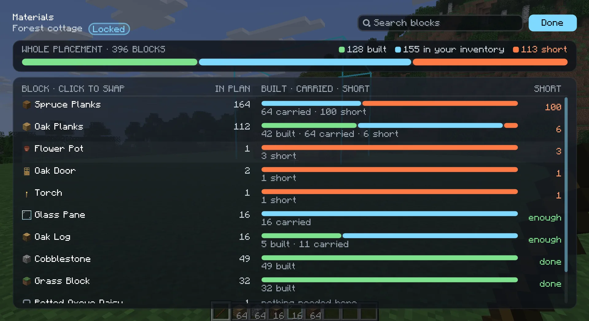

import { Steps } from '@astrojs/starlight/components';

While you build a [locked placement](/play/placement/) by hand, Heavymatica keeps a material list for it: for every
item, how many the build still needs, how many you have, and how many you are short. You see the biggest shortages in
the overlay and the full list in the materials screen. The same screen also lets you swap the schematic's blocks for
others, for example spruce instead of oak.

## What counts

The material list only exists while the selected placement is locked. Following and anchored placements have none.

It counts what is still left to do, not the whole schematic:

- A position counts when its block is missing, when the wrong block stands there, or when Heavymatica hasn't compared it
  with the world yet. Parts of the build in chunks that aren't loaded count in full.
- A position that is only partly done counts only the rest. Two of three planned candles need one more candle. A bottom
  slab where a double slab is planned needs one more slab.
- A position that matches, is only turned the wrong way, has too many, or only needs a finishing step needs no item.
  Stairs facing east where the plan has them facing north need no new stairs.
- Only the layers you can see count. If you show layers 4 to 6, the list counts only what layers 4 to 6 still need.
  In follow feet mode the list grows as you climb. See [Layers](/play/layers/).
- The in-hand filter does not change the list.

Some blocks count differently from one item per position:

| Block | Counts as |
| --- | --- |
| Doors, beds, tall plants | One item for both halves |
| Double slab | Two slabs |
| Candles, sea pickles, snow layers | As many items as the block has |
| Potted plant | One flower pot and one plant |
| Candle cake | One cake and one candle of the same colour |
| Water, lava or powder snow cauldron | One cauldron and one matching bucket |
| Grass block, dirt path, farmland | Dirt |
| Stripped logs and wood | The unstripped log or wood of the same type |
| Concrete | Concrete powder of the same colour |

Blocks that the same item places add up in one row. Twenty dirt paths, ten farmland and five grass blocks show as 35
dirt.

### Can't carry

Some blocks have no item that places them: water and lava sources, fire, portals, piston heads and the like. They are
listed in a separate **Can't carry** part with how many positions still need them. They never show as a shortage.

## What you have

"Have" is everything you carry:

- your main inventory and hotbar
- your offhand
- the contents of shulker boxes and bundles you carry, also nested ones
- the contents of other carried items that hold items, when the mod that adds them lets other mods look inside

Each item counts once, even inside nested containers. Chests and other containers in the world don't count, even right
next to you. If you carry 10 oak planks and a shulker box with 64 more, you have 74.

Blocks the game lets you swap in count toward what you have. For a planned grass block, a grass block you carry counts as
well as dirt. For planned concrete, both concrete and concrete powder count. The other way round does not work: concrete
you carry does not count for planned concrete powder. Each carried item counts toward one planned block only, so nothing
counts twice.

## The overlay

While you hold the remote with a locked placement selected, the overlay shows a **Fetch** section with up to three items
you are shortest on, largest first. When you carry everything the visible layers still need, it says **Nothing short**.

If more items are short, a line says how many more, for example `+2 more short (K: Materials)`. It names the materials key
when you have bound one, or the wheel key and its Materials segment when you haven't.

## The materials screen

Open it with the remote in your hand:

- pick **Materials** on the [placement wheel](/play/remote/) (<kbd>V</kbd>), or
- press the **Open materials** key. It has no key by default; bind one in Options → Controls. See
  [Keys](/play/keys/).

It works for the selected placement in every state. With no placement selected, the key tells you to select one first.
The screen doesn't pause the game and updates while it is open, so you can pick up items and watch the counts change.

Each row is one block type of the schematic, with how many positions use it and what it shows as. A search box at the top
narrows the rows by block name or ID.

### While the placement is locked

Each row also shows **Need**, **Have** and **Short**, with a shortage above 0 in red. A bar per row shows the planned
positions in the visible layers:

- green: already built
- blue: what you carry, up to what is still needed
- orange: what is short, with the number beside the bar

A bar at the top sums this for the whole placement. Rows are sorted by most short first, then most needed. The
**Can't carry** part follows.

A **Finish** column shows positions that are built but still need a finishing step, such as dirt paths that need a
shovel, farmland that needs a hoe, logs that need an axe or concrete powder that needs water. See
[Comparison](/play/comparison/).

### While it is not locked

Rows are sorted by most used first and show no need, have or short counts.

## Swapping materials

You can replace a block type of a placement with another block, for example oak planks with spruce planks. The swap
belongs to that placement only. The schematic itself doesn't change, and you don't need to upload anything.

<Steps>
1. Open the materials screen.
2. Click the name of the row you want to change. The block picker opens.
3. Pick the new block. The swap applies at once and the picker closes.
</Steps>

In the picker:

- Blocks of the same kind come first as **Suggested**, for example other stairs when you swap stairs. **All blocks**
  follow.
- Type to search by name.
- Each block shows how many you carry, and says **enough** when that covers what the row needs. Below, the picker says
  whether the chosen block is enough or how many you would be short.
- **Keep original** takes the swap back.
- <kbd>Esc</kbd> closes the picker without a change.

A swapped row shows the new block in the accent colour. Hover it to see what it was swapped from. The undo button next to
it resets the swap.

What a swap does:

- It changes every position of that block type, in every orientation. Stairs keep their facing, half and waterlogging
  when the new block has them too. Swapping stairs to planks just gives planks.
- Other block types stay as they are. Swapping oak stairs to spruce stairs leaves the oak planks oak.
- Swaps don't chain. If you swap oak planks to spruce and spruce planks to birch, the former oak becomes spruce and the
  former spruce becomes birch.
- Ghosts, the in-hand filter, the comparison, the overlay and the material list all use the swapped blocks.
- You can swap in any placement state. On a locked placement the comparison starts over: already built oak stairs show
  as wrong once you swap them to spruce.

The overlay shows how many swaps the selected placement has.

If you swap to a block from a mod you later remove, the placement shows the original block again. The materials screen
marks that swap as missing and keeps it until you change or remove it.

## Unknown blocks

A schematic can contain blocks this game doesn't know, for example from a mod you haven't installed, such as
`create:shaft` without Create, or from a newer Minecraft version.

- In the world, they show as purple-and-black missing-texture cubes at ghost opacity.
- The overlay counts them: `Unknown blocks: 2 types, 40 positions`.
- They are never compared and never count as needed or short. The material list and the materials screen list them last,
  under **Unknown blocks**, with their ID and how many positions in the visible layers use them.
- In the materials screen you can click an unknown row and swap it for a block you have. Swapping `create:shaft` to
  iron chain shows chains where the shafts were, and those positions are compared and counted from then on.

To hide the missing-texture cubes, pick **Options → Unknown blocks** on the wheel (it shows when the selected placement
has unknown blocks) or turn off
`[ghost] showUnknownBlocks` in the [settings](/play/settings/). Hiding only changes what is drawn: the counts and rows
stay.

:::note
Schematics saved in older Minecraft versions are upgraded when you use them, the way the game upgrades old worlds. Old
`minecraft:grass` shows as short grass and is not unknown. The file itself stays as it was.
:::
