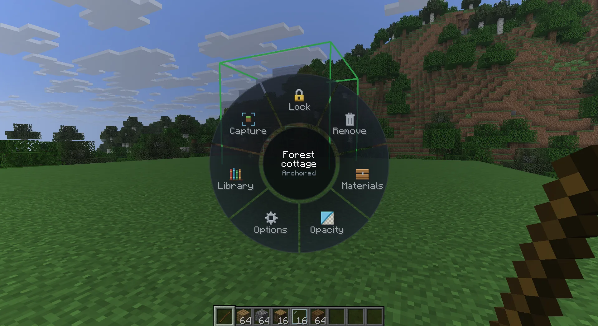
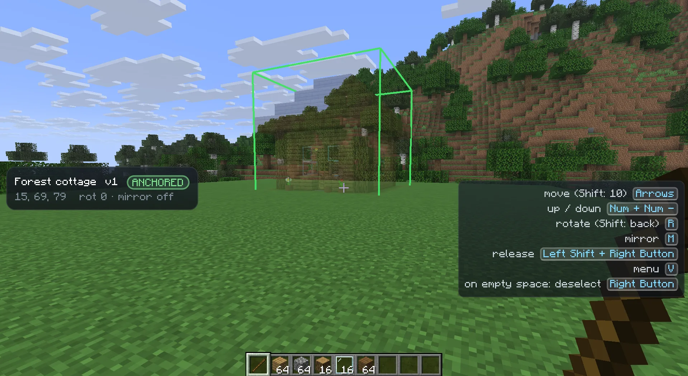

import { Aside } from '@astrojs/starlight/components';

The remote is the item you hold to control placements. While it is in your main hand, Heavymatica takes over a few
keys and right-click, shows a status panel and lists the keys you can use.

## Which item is the remote

By default the remote is a **stick**. Heavymatica adds no item of its own, so the remote works on every server,
vanilla servers included.

- Change the item with [`[remote] item`](/play/settings/), for example to `minecraft:blaze_rod`. Then a stick is just a
  stick again. In the in-game settings you can also hold the item and click **Use held item**.
- Items in the item tag `heavymatica:remotes` always count as a remote too. A server or data pack can add items to that
  tag.

Only the main hand counts. A remote in your off hand does nothing.

## What the remote changes

While you hold the remote and no screen is open:

- **Right-click** belongs to Heavymatica. It anchors, releases and selects placements, or opens the library. The click
  is not used on blocks, so a chest you right-click doesn't open.
- **Left-click** and the **mouse wheel** work as usual.
- The placement keys below work.

## Keys

All keys are in Options → Controls, in the **Heavymatica** category, and you can rebind every one of them. See
[Keys](/play/keys/) for the full list.

| Action | Default key | Needs the remote |
| --- | --- | --- |
| Open schematic library | <kbd>H</kbd> | No |
| Move placement away / closer | <kbd>↑</kbd> / <kbd>↓</kbd> | Yes, except for layers on a locked placement |
| Move placement left / right | <kbd>←</kbd> / <kbd>→</kbd> | Yes |
| Move placement up / down | <kbd>Numpad +</kbd> / <kbd>Numpad -</kbd> | Yes, except for layers on a locked placement |
| Rotate placement (<kbd>Shift</kbd>: other way) | <kbd>R</kbd> | Yes |
| Mirror placement | <kbd>M</kbd> | Yes |
| Open placement wheel | <kbd>V</kbd> | No, while a placement is selected |
| Remove placement | not bound | No, while a placement is selected |
| Lock / unlock placement | not bound | Locking no, unlocking yes |
| Toggle in-hand filter | not bound | No, while a locked placement is selected |
| Open materials | not bound | No, while a placement is selected |
| Cycle layer mode (<kbd>Shift</kbd>: back) | not bound | No, on a locked placement |

The unbound keys are all on the wheel. If you use one of them a lot, bind a key for it in Options → Controls.

On a locked placement, <kbd>↑</kbd>, <kbd>↓</kbd>, <kbd>Numpad +</kbd> and <kbd>Numpad -</kbd> control its
[layers](/play/layers/) instead of moving it, and <kbd>←</kbd>, <kbd>→</kbd>, <kbd>R</kbd> and <kbd>M</kbd> do nothing.
In [capture mode](/play/capture/) the arrow keys move the capture box's corner instead.

## Right-click

What right-click with the remote does depends on the selected placement and where you look:

| Situation | Right-click does |
| --- | --- |
| The selected placement is following | Anchors it where it is |
| You look at another placement's ghost | Selects that placement |
| You look at empty space and a placement is selected | Deselects it; it stays where it is |
| You look at empty space and nothing is selected | Opens the library |

Sneak + right-click releases an anchored placement, so it follows your crosshair again. On anything else it does
nothing.

See [Placing and moving](/play/placement/) for anchoring, releasing and selecting.

## The placement wheel

Press <kbd>V</kbd> to open the wheel around the middle of the screen. It gathers the actions you don't need every
second. The game keeps running while it is open, and you can keep walking with your movement keys. Moving the mouse only
points at segments; the camera doesn't turn.

The wheel opens while you hold the remote, or without the remote while a placement is selected (not in capture mode).

### Hold or toggle

[`[wheel] mode`](/play/settings/) decides how you pick a segment:

- **Hold** (default): hold <kbd>V</kbd>, move the mouse towards a segment and let go. Letting go with the mouse in the
  middle closes the wheel without doing anything.
- **Toggle**: tap <kbd>V</kbd> to open the wheel and click a segment. Tap <kbd>V</kbd> again or click the middle to
  close it.

<kbd>Esc</kbd> always closes the wheel without doing anything.

Hovering a segment shows its name and a one-line hint in the middle of the wheel. With nothing hovered, the middle names
the selected placement and its state. A greyed-out segment does nothing and its hint says why.

### Main ring

Which segments show depends on the selected placement:

| Selected placement | Segments |
| --- | --- |
| None | Materials (greyed out), Opacity, Library, Capture |
| Following | Cancel, Materials, Opacity, Options, Library |
| Anchored | Lock, Remove, Materials, Opacity, Options, Library, Capture |
| Locked | Unlock, Options, Layers, Materials, Opacity, Library, Capture |

Some segments only show at certain times:

- **Bring back** comes first for 10 seconds after a placement [finished](/play/comparison/).
- **Paste** follows Materials on a locked placement, and **Undo paste** comes last after a paste. Both only show in
  your own world in creative mode. See [Creative paste](/play/creative-paste/).
- **Capture** only shows while you hold the remote.

What each segment does:

| Segment | What it does |
| --- | --- |
| Library | Opens the [library](/play/library/). |
| Cancel | Drops the following placement at once. |
| Lock | Locks the anchored placement for building. |
| Remove | Asks first, then removes the anchored placement. |
| Unlock | Asks first, then makes the locked placement movable again. Needs the remote. |
| Layers | Opens the Layers page. |
| Materials | Opens the [materials](/play/materials/) screen of the selected placement. |
| Opacity | Opens the Opacity page. |
| Options | Opens the Options page. |
| Capture | Starts [capture mode](/play/capture/). |
| Bring back | Brings back the placement that just finished. |
| Paste / Undo paste | See [Creative paste](/play/creative-paste/). |

### Confirming Remove and Unlock

Remove and Unlock never act on the first pick. The wheel shows **Yes** and **Cancel** with a question such as
`Remove "Castle Gate"?`. Pick Yes to do it. Cancel, <kbd>Esc</kbd> or the middle backs out. In Hold mode, letting go of
<kbd>V</kbd> on Remove or Unlock leaves the question open, and you click your answer. One flick never removes a
placement.

### Sub-pages

Layers, Opacity, Options and Mistakes open a page of their own. In Hold mode, letting go of <kbd>V</kbd> on one of them
leaves the page open, and you click your choice. The setting in effect is marked. Options that switch something on or
off are also tinted green while they are on.

| Page | Segments |
| --- | --- |
| Layers | Off, From-to, Follow feet. See [Layers](/play/layers/). |
| Opacity | One segment per opacity step, such as 20%, 40%, 60%, 80% and 100%. See [Placing and moving](/play/placement/). |
| Options (locked placement) | In-hand filter, Easy Place, Placement restriction, Unknown blocks (only when the placement has some), Pin overlay, Mistakes |
| Options (following or anchored) | Unknown blocks (only when the placement has some), Pin overlay |
| Mistakes | Off, Mistakes, Mistakes and missing. See [World comparison](/play/comparison/). |

The Options:

- **In-hand filter**: shows only ghosts of the blocks in your hotbar. See [Layers](/play/layers/).
- **Easy Place**: right-clicking a ghost places the planned block for you. See [Easy Place](/play/easy-place/).
- **Placement restriction**: refuses blocks that don't match the plan. See [Easy Place](/play/easy-place/).
- **Unknown blocks**: shows or hides blocks your game doesn't know, for example from a mod you don't have. Saved as
  [`[ghost] showUnknownBlocks`](/play/settings/).
- **Pin overlay**: keeps the status panel on screen without the remote. The action bar says `Overlay pinned` or
  `Overlay unpinned`.
- **Mistakes**: opens the Mistakes page for the mistake pointer.

### Without the remote

With a placement selected, you can open the wheel while holding blocks or tools, so you don't have to switch back to
the remote while building. Everything works as with the remote, except that **Unlock** is greyed out (hold the remote
to unlock) and **Capture** doesn't show.

### Wheel settings

| Setting | Default | What it does |
| --- | --- | --- |
| [`[wheel] mode`](/play/settings/) | `HOLD` | Hold or Toggle, see above. |
| [`[wheel] animations`](/play/settings/) | `true` | Animates opening, page changes, highlights and closing. Off shows each state at once. |
| [`[wheel] sounds`](/play/settings/) | `true` | A quiet tick when another segment is highlighted, and a click when you pick one. |

Animations never slow you down: a quick flick works even before the opening animation is done.

## Key hints

While you hold the remote, the bottom-right corner lists the keys you can use right now, with the keys you actually
bound. The list changes with the placement's state. For example, a following placement shows anchoring, up and down,
rotating, mirroring and the menu, but no arrow keys.

- The wheel key always shows as `menu`, for example `V menu`.
- Actions that live on the wheel only get a hint when you bound a key for them.
- On a locked placement the list starts with a header for its layers, such as `From-to: layers 4-6 of 12`, followed by
  the layer keys.
- The list moves up when subtitles are on, and above the hotbar when the screen is too narrow.

Turn the hints off with [`[overlay] keyHints`](/play/settings/).

## The overlay

While you hold the remote, a panel on one side of the screen shows the selected placement, or `No placement selected`.
Choose the side with [`[overlay] side`](/play/settings/) (`LEFT` or `RIGHT`).

For every placement it shows:

- its name and version (`local` for a schematic that is only on your computer)
- a state badge: **FOLLOWING**, **ANCHORED** or **LOCKED**
- its position, rotation and mirror, such as `128, 64, -40` and `rot 90 · mirror off`
- how many [material swaps](/play/materials/) it has, if any
- how many block types the game doesn't know, and at how many positions, if any
- `Version unavailable: offline or deleted` when its schematic can't be loaded

For a locked placement it also shows:

- its layers, such as `Layers 4-6 of 12`, and whether the in-hand filter is on
- its progress, such as `Built 62%  3104 / 5006`, or `Scanning...` right after locking, and the progress of the visible
  layers
- the mistake counts in their colours, such as `12 wrong`, `4 turned`, `2 water`, `3 extra`
- in yellow, how many blocks still need a shovel, hoe, axe or water
- a progress bar: built in green, carried in your inventory in blue, short in orange
- the materials you are short of, or `Nothing short`

See [World comparison](/play/comparison/) and [Materials](/play/materials/) for what these numbers mean.

### Pinning the overlay

Normally the panel disappears when you put the remote away. Pin it to keep it on screen while you build with blocks in
your hand: pick **Options**, then **Pin overlay** on the wheel, or set [`[overlay] pinned`](/play/settings/).

A pinned panel shows only while a placement is selected. Without the remote, the corner list then shows only the layer
header and layer keys of a locked placement. <kbd>F1</kbd> hides both, as it hides the rest of the HUD.

<Aside type="tip">
Pin the overlay and use Follow feet layers. Then you can build with blocks in your hand and still see your progress and
shortages.
</Aside>
