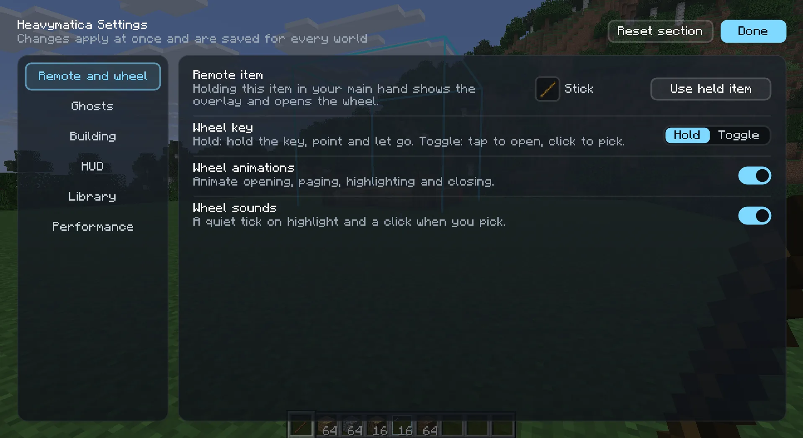

import { Aside, Tabs, TabItem } from '@astrojs/starlight/components';
import SettingsReference from '../../../components/SettingsReference.astro';

Heavymatica keeps its settings in `config/heavymatica-client.toml` in your game folder. It is the same file with the
same settings on Fabric and NeoForge, so you can copy it from one to the other.

## The settings screen

The easiest way to change settings is the settings screen in the game. Open it from the gear button at the top of the
[library](/play/library/) (<kbd>H</kbd>), or from the mods list:

<Tabs syncKey="loader">
  <TabItem label="Fabric">
    With [Mod Menu](https://modrinth.com/mod/modmenu) installed, open the **Mods** screen, select Heavymatica and click
    its config button. Without Mod Menu, use the gear button in the library.
  </TabItem>
  <TabItem label="NeoForge">
    Open the **Mods** screen, select Heavymatica and click **Config**.
  </TabItem>
</Tabs>

**Done** takes you back to where you came from.

The settings are grouped into the sections **Remote and wheel**, **Ghosts**, **Building**, **HUD**, **Library** and
**Performance**. Each setting has a short explanation. **Reset section** puts the section you are looking at back to its
defaults and leaves the others alone.

A change takes effect at once, even while the screen is still open, and is saved to the file. A value outside the
allowed range is not accepted.

A few settings are easier on the screen than in the file:

- **Remote item**: hold the item you want and click **Use held item**. It needs an item in your main hand and an open
  world.
- **Opacity steps** for the wheel: add and remove steps in a list. You can have 2 to 8 steps from 5% to 100%.
- **Heavymatica Cloud**: Automatic, Always or Never. See [Library](/play/library/) for what each does.

The cloud address and the settings meant for development are only in the file.

## Editing the file

You can also open `config/heavymatica-client.toml` in a text editor. If a value is missing or not valid, Heavymatica
uses its default instead.

<Tabs syncKey="loader">
  <TabItem label="Fabric">
    Fabric reads the file when the game starts. Changes you make to the file while the game runs take effect at the
    next start. Use the settings screen to change things while you play.
  </TabItem>
  <TabItem label="NeoForge">
    NeoForge notices when you save the file while the game runs and uses the new values.
  </TabItem>
</Tabs>

<Aside>
  Leave `cloudUrl` as it is. `devSessionJoinUrl` is for development only and should stay empty. `compact` under
  `[overlay]` is an old setting that **Show key hints** (`keyHints`) has replaced.
</Aside>

## All settings

Each table below is one section of the file, with every setting, what it does and its default.

<SettingsReference />
