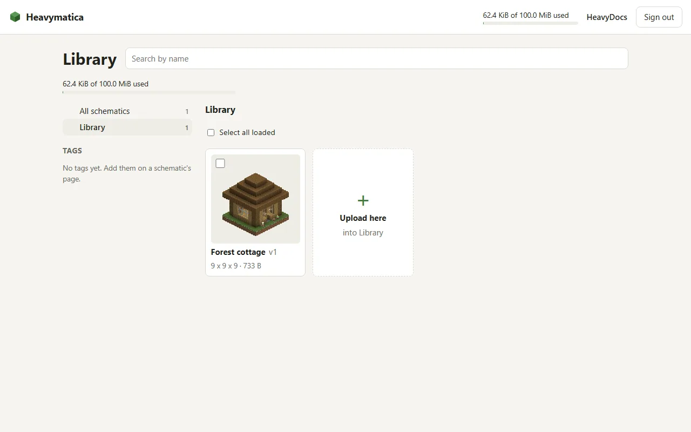
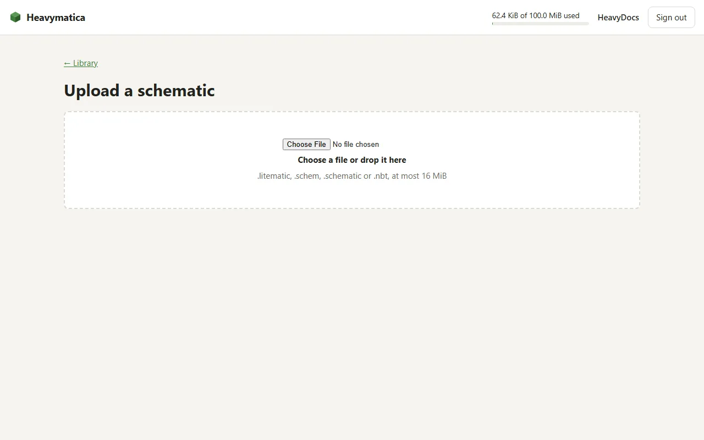
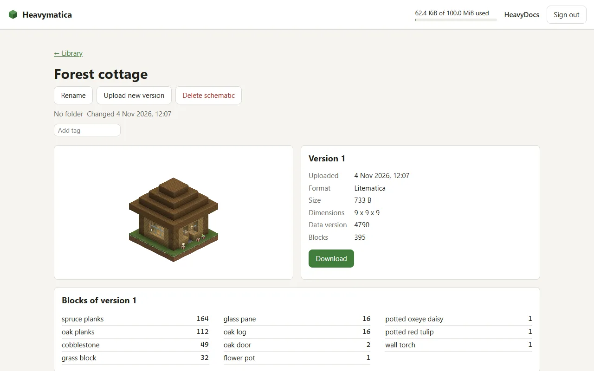

import { Aside, Steps } from '@astrojs/starlight/components';

The player website belongs to the Heavymatica Cloud. It shows the same cloud library as the game: you can upload,
organize and download your schematics from any browser, and link your GitHub sign-in to the account you use in the
game.

<Aside type="caution" title="Not open yet">
  The Heavymatica Cloud is in alpha and not open to the public yet, and neither is the website. This page describes how
  it works once it is.
</Aside>

## Signing in

The website signs you in with GitHub. There are two buttons:

- **Register with GitHub** creates a new account for your GitHub sign-in.
- **Sign in with GitHub** opens the account your GitHub sign-in already belongs to.

The first time you sign in with GitHub, the website asks whether to **Create a new account** or **Join an account from
the game**. Nothing is created until you choose. A new account starts with an empty library, separate from the one in
the game. To use one library in both places, join the account from the game instead.

Heavymatica only stores your GitHub user ID and name, never your email address.

**Sign out** is on every page. If your session ends while a page is open, the website takes you back to the sign-in and
says you were signed out.

## Joining your game account

If you already use the cloud in the game, add your GitHub sign-in to that account with a link code:

<Steps>
1. In the game, open the library with <kbd>H</kbd>, click your name and choose **Link another sign-in**. The game shows
   a code such as `K7QM-3XRP` and a QR code.
2. Scan the QR code with your phone. It opens the website's link page with the code filled in. If you aren't signed
   in yet, sign in with GitHub and you come back to the page with the code kept. Or, on your first GitHub sign-in,
   choose **Join an account from the game** and type the code.
3. Click **Link**. The website says what will be linked and waits for the game.
4. In the game, check the name it shows and click **Confirm**.
5. The website says **Linked**, and from then on your GitHub sign-in opens your game library.
</Steps>

The same page works the other way round. When a second Minecraft account signs in in the game and chooses **Join an
account I have**, the game shows a code and a QR code. Open it on the website while signed in to the account to join,
then confirm in the game.

Nothing is linked until it is confirmed in the game. If the player in the game declines, the website says so and
nothing is linked. A code that is unknown, used or expired is refused, and you can try another one. Codes are only ever
shown in the game. See [Library](/play/library/) for the game's side.

## The library

The library opens on the top level, like a file explorer:

- Folder cards first, then the schematics in no folder. Each folder card shows how many schematics are in it and below
  it.
- Open a folder to see its subfolders and the schematics directly in it. The breadcrumb, for example
  Library › village, takes you back up.
- **All schematics** shows every schematic at once, without folder cards.
- The folder tree beside the cards shows all your folders with their counts. Folders with subfolders expand and
  collapse. On a phone, the tree opens from a folder button.

Each card shows the thumbnail or a placeholder, the name, the latest version number, the size in blocks and the file
size. Point at a card to see when it last changed. The newest changes come first. When there are many schematics, ask
for more at the end of the list.

The open folder, the chosen view and the tag are part of the page address. Reloading, sharing the address or the
browser's back button brings you back to the same place.

### Searching and tags

Type in the search box to filter by name as you type. The tag list shows every tag with the number of schematics that
carry it. Click a tag to filter by it, and click it again to clear it. Search and tag work together.

Search and tags look in the open folder and every folder below it, and say which folder the results come from. On the
top level they look everywhere.

### Moving and renaming

- Select one or more cards, or all loaded ones, and move them to a folder: pick one from the tree, type a new path such
  as `harbor` or `builds/medieval`, or move them out of every folder.
- Or drag selected cards onto a folder card or a folder in the tree.
- Rename a folder to give it a new path. Everything in it and below it moves along. If the new path is a folder that
  already exists, the website warns that the two will be merged and waits for you to confirm.

Right-click a card for a menu to open, rename, move or delete it. With several cards selected, the menu moves or
unselects all of them. Right-click a folder to open, rename or move it. The menu also opens with the menu key or
<kbd>Shift</kbd>+<kbd>F10</kbd>, and closes with <kbd>Esc</kbd>.

## Uploading

Uploads go into the folder you have open (in **All schematics**, into the top level):

- Drop files anywhere on the cards.
- Click the **Upload here** card after the last card.
- Right-click an empty spot and choose to upload.

To upload into another folder, drop files onto its folder card or onto it in the tree, or choose **Upload into this
folder** from its menu.

The website takes `.litematic`, `.schem`, `.schematic` and `.nbt` files up to 16 MiB, the same as the game. Several
files upload one after another, each with its progress and result. A file that is too large is reported and not sent;
the others still upload. The website also explains other rejections, such as a format it doesn't read or a full
storage.

A new upload shows a placeholder at first. The thumbnail appears on its own once it has been rendered.

## Schematic details

Click a card to open its details: the name, folder, tags and every version with its number, upload time, format, file
size, size in blocks, Minecraft data version and block count. For the chosen version you see the thumbnail, the block
counts per block type, largest first, and a download of the file.

On the details page you can:

- **Upload a new version.** It is added on top of the latest. Uploading the exact file of the latest version again adds
  nothing; the website says the file is unchanged.
- **Rename** the schematic. Its versions stay as they are.
- **Edit tags.** A schematic can have up to 20 tags of 1 to 50 characters. Changing tags doesn't create a version.
- **Delete a version.** The only version can't be deleted; delete the schematic instead.
- **Delete** the schematic with all its versions.

Deleting always asks first and names what will be deleted.

## Storage

While you are signed in, the website shows how much of your storage you use, for example 14 MiB of 100 MiB. It updates
after uploads and deletions. When an upload would go over your quota, the website says the storage is full and nothing
is stored. Delete schematics or versions to make room.
